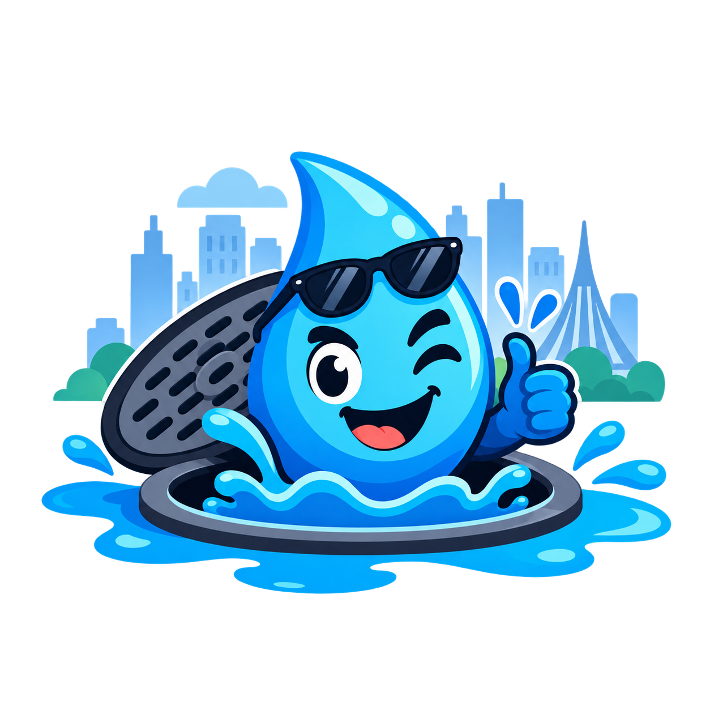

# DubsiBhai - Drainage Waterlogging Management for Dhaka

<p align="center">
  
  <br>
  <strong>Collaborative Community Platform</strong>
</p>

Urban waterlogging and drainage management for Dhaka. This repository contains the frontend, backend, and machine learning service for the DubsiBhai project. The frontend is built with Next.js, while the backend and ML service are built with FastAPI.

The repository root is `CSE-4113-Project/`.

- [Project structure](docs/architecture/MONOREPO_ARCHITECTURE.md)
- [System design](docs/architecture/SYSTEM_DESIGN.md)
- [Developer setup: run the complete project](DEVELOPMENT.md)
- [Civic app setup and workflows](docs/guideline/CIVIC_DEVELOPMENT.md)
- [Live map, Google Maps switch and road-risk model](docs/guideline/LIVE_MAP.md)
- [Automatic release versions after dev-to-main merges](docs/guideline/RELEASES.md)
- [Database schema, normalization and indexes](db/README.md)

## High-level architecture

The target architecture combines a FastAPI modular monolith with a separate ML
service. The core API owns business data, authorization, and workflow decisions;
an API-owned background worker calls ML over HTTP and saves versioned results.


The civic implementation includes authenticated reports and road updates, public
map overlays, worker approval/assignment/completion, community verification,
points, moderation and mayor analytics. Background workers project transactional
events into **MongoDB** and obtain category suggestions from the existing ML service.
PostgreSQL remains the source of truth; Redis provides shared rate limits and
short-lived auth state. Duplicate detection, improved road-risk prediction,
ML geographic clustering, IoT ingestion and production HTTPS remain future work.
The diagram predates these additions; the linked database/workflow guides describe
the implementation. External integrations provide Google sign-in, map tiles and email.

## Run on Linux with Docker

Install Bash, Docker Engine (or Docker Desktop) and the Docker Compose v2 plugin.
Make sure `docker info` succeeds, then run from the repository root:

```bash
bash scripts/start.sh
```

This is the Linux equivalent of root `start.ps1`: it builds and starts the whole
stack, creates missing environment files, applies migrations and trains missing
models. Node.js, Python and uv run inside Docker. Open http://localhost:3000.

```bash
bash scripts/start.sh --status          # Inspect containers
bash scripts/start.sh --logs            # Follow logs; Ctrl+C exits logs only
bash scripts/start.sh --stop            # Stop the stack; keep database/model volumes
bash scripts/start.sh --no-build        # Start using existing images
bash scripts/start.sh --timeout 1200    # Allow more time for first startup
bash scripts/start.sh --data-only      # Start only databases, Redis and Mailpit
```

Run only one launch mode at a time; they share ports 3000, 8000 and 8001. Bash
commands work without changing executable permissions. See [scripts/README.md](scripts/README.md)
for Linux migration, seed and lint helpers, and how the PowerShell scripts relate.

## Run on Windows

See [DEVELOPMENT.md](DEVELOPMENT.md) for first-time configuration, all services,
logs, shutdown, migrations, training and troubleshooting. Choose one startup mode.

### Which launcher should I use?

**Use `.\start.ps1` for the standard setup and for teammates.** It runs the whole
project in Docker. Use `.\run.ps1` when you want to debug the application processes
directly on your computer.

Both launch the same project, but run its services in different places:

| | `start.ps1` | `run.ps1` |
| --- | --- | --- |
| Frontend, API, ML service and background workers | Docker containers | Directly on your computer |
| PostgreSQL, MongoDB, Redis and Mailpit | Docker containers | Docker containers |
| Requirements | Docker Desktop and PowerShell | Docker Desktop, PowerShell, Node.js, Python and uv |
| Stop application services | `.\start.ps1 -Stop` | Ctrl+C in the launcher terminal |
| Data services after stopping | Stopped; volumes preserved | Keep running; stop with `.\start.ps1 -DataOnly -Stop` |
| Model weights | Persistent Docker volume | `apps/ml-service/weights/` by default |

**Run only one mode at a time:** both use ports **3000, 8000 and 8001**. Before
switching from Docker to host mode, run `.\start.ps1 -Stop`. Before switching back,
press Ctrl+C in the `.\run.ps1` terminal and stop any independently launched app servers.
The model files are stored separately in the two modes; each trains missing weights
from the repository's datasets automatically.

`scripts/run-all.ps1` is an internal helper called by root `run.ps1`: it installs
dependencies and supervises the host apps/workers after Docker data services start.
Start through root `run.ps1` so its prerequisite checks and data setup run first.
It is separate from the all-Docker launcher `start.ps1`.

### Run everything with Docker

Install and start Docker Desktop with Linux containers, stop any manually running
app servers, and run this from the repository root:

```powershell
.\start.ps1
```

This starts the frontend, API, ML service, PostgreSQL, Redis, MongoDB, Mailpit,
and Nginx. Images and dependencies download automatically; migrations and initial
synthetic ML training run automatically. Existing environment files are retained,
and database/model data persists in Docker volumes.

Open http://localhost:3000. Use `.\start.ps1 -Logs` to follow logs and
`.\start.ps1 -Stop` to stop without deleting data. Teammates only need Docker
Desktop and PowerShell for this path; host Node.js and Python are unnecessary.
See [Docker development](docs/guideline/DOCKER_DEVELOPMENT.md) for ports, Google sign-in,
retraining, and troubleshooting. Set server-only `ADMIN_EMAIL`, `ADMIN_PASSWORD`
and `ADMIN_NAME` in the root `.env` before the first mayor bootstrap.

### Run apps directly on the host

Install Node.js 20.9+ (22 recommended), Python 3.11+, and [uv](https://docs.astral.sh/uv/), then open PowerShell.
A global pnpm installation is not needed. First launch requires internet access to install dependencies.

Start Docker Desktop, then run this from the repository root:

```powershell
.\run.ps1 -Check
.\run.ps1
```

The root launcher starts PostgreSQL, MongoDB, Redis and Mailpit in Docker,
installs locked dependencies, migrates the database, bootstraps the configured
mayor, prepares a missing ML model, and starts the three apps and both background
workers. It waits for readiness, then supervises them until you press Ctrl+C.
Logs are written to the unique `.cache/run-all/` directory printed in the terminal.
If an app exits, the launcher stops the others. Occupied ports are reported before startup.
Docker data services remain running after Ctrl+C; stop them with
`.\start.ps1 -DataOnly -Stop`. Existing environment files and data are retained.

To run just one app, enter its folder and use `./run.ps1` (the extension is `.ps1`):

```powershell
cd apps/web
./run.ps1
```

The same command works inside `apps/api` and `apps/ml-service`.
Each launcher synchronizes locked dependencies, starts its development server with reload,
and restores your working directory when it exits. Press Ctrl+C to stop an individual server.

| App | URL | API documentation |
| --- | --- | --- |
| Next.js frontend | http://localhost:3000 | - |
| Core FastAPI service | http://localhost:8000/ | http://localhost:8000/docs |
| FastAPI ML service | http://localhost:8001/ | http://localhost:8001/docs |
| Local service hub (Docker) | http://localhost:8080/ | - |

The API root shows live process health and documentation links. The ML root
shows model readiness and includes a Bengali complaint classification form.
The Docker service hub links to all three apps. Health and data endpoints
continue to return JSON for app clients and automated checks.

JavaScript tooling and dependencies live entirely inside `apps/web`.
Each Python service has its own `.venv`, `pyproject.toml`, and `uv.lock`.
The API also exposes `/api/v1/health`. API `/health` checks process liveness;
ML `/ready` checks that its classifier is loaded.

## Configuration and checks

The root launchers create missing environment files from their examples. To customize settings,
edit `.env` at the root and `apps/web/.env.local`. The Python services read the root
`.env`; Next.js reads its app-local environment file. Restart the affected app after editing settings.

From `apps/web`:

```powershell
npx --yes pnpm@10.34.5 lint
npx --yes pnpm@10.34.5 typecheck
npx --yes pnpm@10.34.5 build
```

From either Python app directory:

```powershell
uv run pytest
```

The ML service now supports Bengali complaint classification using the synthetic dataset.
The launchers train a missing model automatically; existing artifacts are preserved.
After replacing the CSV with real data, run `./train.ps1 -DataSource real` and restart the service.
See the [ML service guide](apps/ml-service/README.md) for inference and evaluation details.

The API now includes email/password and Google authentication, revocable sessions,
email verification and reset, database migrations, and Redis leaky-bucket limits.
See [the API guide](apps/api/README.md) for API configuration. The bilingual web app
includes public road/complaint maps, citizen reporting, worker applications and
workflows, community verification, mayor administration, login/signup, email
verification, password recovery, and account/session management. See the
[web setup guide](apps/web/README.md) for Google sign-in. Local verification and
reset messages are captured at http://localhost:8025; they are not delivered to
real inboxes. Phone verification, improved prediction/clustering, IoT readings,
duplicate detection and production deployment remain future work.
