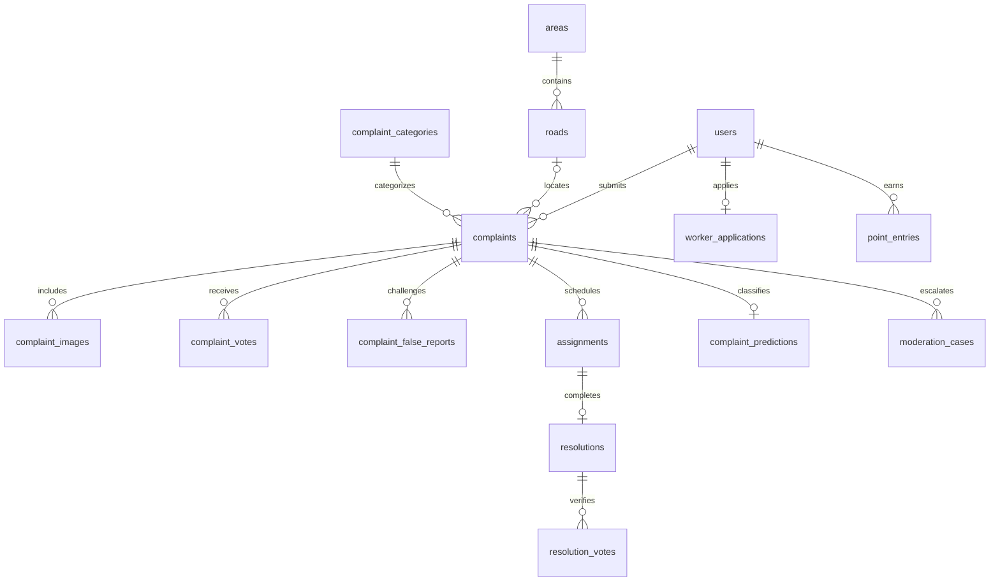

# PostgreSQL and MongoDB design

The executable PostgreSQL schema is [`schema.sql`](schema.sql), a **file** under
`db/`. It targets PostgreSQL 17. The existing auth tables remain compatible; the
new domain tables are maintained by Alembic revisions `20261015_02` and `20261015_03`.

## Install and migrate

For the project database, run from `apps/api`:

```powershell
uv sync --locked
uv run python -m alembic upgrade head
uv run python -m app.workers.bootstrap
```

For a completely empty database, `psql -v ON_ERROR_STOP=1 -f db/schema.sql`
creates the same tables, indexes, category catalog and Alembic revision marker.
Use **one** installation path; do not import the snapshot into an existing database.
Neither path drops existing auth accounts. Take a backup before upgrading a shared database.

`generate_schema.py` documents how the snapshot was generated. Its migration
generation is for initial development only: freeze released migrations and add
new revisions for future changes.

## Ownership and normalization

| PostgreSQL tables | Responsibility |
| --- | --- |
| `users` | One account/profile, one role: citizen, worker, admin; optional unique normalized phone, DOB, blood group |
| `auth_identities`, `auth_sessions`, `auth_action_tokens` | Google identities, revocable sessions, hashed single-use email tokens |
| `password_history` | At most four previous Argon2 hashes, in addition to the current hash |
| `worker_applications`, `worker_locations` | Private identity review and explicitly shared short-lived availability |
| `areas`, `roads`, `complaint_categories` | Reusable geographic and category catalogs |
| `complaints`, `complaint_images` | Complaints and observations with an optional road reference and optional image rows |
| `complaint_predictions` | Versioned ML category suggestion, confidence, retry state; preserves the submitted category |
| `complaint_votes`, `complaint_false_reports` | Distinct citizen votes and independent worker evidence |
| `assignments`, `resolutions`, `resolution_votes` | Work ownership, completion evidence, citizen confirmation |
| `moderation_cases` | False-report and worker-dispute review queue |
| `point_entries` | Auditable credits/debits, unique operation keys; balance is a SUM, never a mutable cached total |
| `outbox_events` | Transactional events waiting for MongoDB delivery |

Images and vote lists are separate rows rather than arrays embedded in relational
records. Foreign keys and check constraints protect relationships and allowed
states. Composite primary keys enforce one vote/report per account per target.
A partial unique index permits only one active assignment for a complaint.
Optional profile attributes stay private; public responses omit email, phone,
DOB, blood group, NID and exact worker locations.

IDs use UUID strings in `varchar(36)` to preserve compatibility with the existing
auth schema. Timestamps use UTC Unix seconds consistently with auth; retired
password ordering uses microseconds. Application-generated IDs and timestamps
are supplied by SQLAlchemy, rather than database-generated defaults.



## Indexing and clustering

- B-tree indexes support status/category/time queues, an author's latest reports,
  work by worker/status, point history, application review and outbox retries.
- Composite vote keys both enforce uniqueness and support counting per target.
- A partial index covers unsolved complaints; a separate partial unique index
  prevents concurrent active assignments on one complaint.
- `pg_trgm` GIN indexes support literal substring report/name searches, including
  Bengali text. User-supplied `%` and `_` are escaped as literal text.
- `cube` and `earthdistance` provide GiST expression indexes on spherical
  coordinates. Nearby queries use an indexed earth-box candidate filter followed
  by an exact spherical distance check in metres. SQLite is only a unit-test
  fallback, using Haversine distance.
- Complaints have a clustering preference on `(road_id, created_at)` to place a
  road's history together. [`maintenance.sql`](maintenance.sql) performs physical
  `CLUSTER` and `ANALYZE` explicitly after a large import.

PostgreSQL does not continuously maintain physical clustering. `CLUSTER` takes
an exclusive lock, so it is intentionally excluded from API startup and routine
migrations. See the [PostgreSQL CLUSTER documentation](https://www.postgresql.org/docs/17/sql-cluster.html).
Spatial proximity is separate from **geographic complaint clusters**:
`GET /api/v1/map/hotspots` returns a transparent ~300m grid-density baseline.
ML-based geographic clustering remains future work.

## MongoDB and Redis

MongoDB stores flexible projections, not a second editable copy of the workflow:

| Collection | Purpose / indexes |
| --- | --- |
| `civic_events` | Event/audit payloads; unique event `_id`, aggregate/time and event-type/time indexes |
| `road_observations` | Location-bearing report events; `2dsphere` index and road/time index |
| `iot_readings` | Reserved for future IoT ingestion; device/time index and 90-day TTL on BSON `observed_at` |

The event worker upserts using PostgreSQL event IDs and marks delivery only after
Mongo acknowledges the writes. A crash can replay delivery safely; Mongo outages
do not roll back a committed report or its points. PostgreSQL retains undelivered
events for retry. The current public map reads the authoritative PostgreSQL data.
Mongo observations are an append-only history and may include later-disputed
reports; consumers must account for subsequent `complaint.false` events.

Redis provides shared admission control and short-lived Google login nonces.
It is not the points ledger or the durable complaint database.

## First-release policies

1. Email verification is required to contribute. Public reads require no session.
   Bangladesh local phone numbers normalize to `+880…`; international numbers use E.164.
2. Signup explicitly offers citizen or worker enrollment. Worker enrollment creates
   the account and a pending identity application atomically; the account retains
   citizen permissions until approval. An approved application is the only
   public-to-worker transition; only the explicit bootstrap can create an admin.
3. Complaints and road updates earn **1 point**. Rate limits bound contribution spam.
4. **5 distinct active verified citizen dislikes + 2 distinct approved active
   workers with images** mark a report false. The author's entire current balance
   is deducted exactly once, active assignments are cancelled, and an admin case opens.
   Automatic blocking is deliberately absent; only the mayor can block an account.
5. A completion needs **5 distinct active verified citizen approvals** to resolve
   the complaint and award **5 worker points**, once per completion. A single dislike
   with image evidence creates a worker-dispute case and reopens the complaint.
   If its completion credit was awarded, up to that 5-point credit is reversed,
   without making the balance negative after an earlier forfeiture.
6. Self-voting and resolving one's own report are rejected. Worker/admin votes do
   not count as citizen confirmations. Duplicate votes update the existing vote.
7. Admin dismissal can reverse a case's point deduction through a new ledger
   entry. Reviews are single-use. A dismissed false-report decision is final for
   that report; evidence accepted as `actioned` leaves the community verdict in place.
8. Automatic assignment considers approved available workers who shared their
   location within 15 minutes, preferring fewer active tasks, then distance.
   Completion is restricted to the active assigned worker.
9. Open civic complaints mark a catalogued road bad. Otherwise the latest good/bad
   observation or confirmed completion within 24 hours determines its condition;
   without recent evidence it is unknown. Three reports within 90 days mark
   **historical sensitivity**, not a calibrated prediction of flooding.
10. The current ML classifier runs asynchronously. At confidence >= 0.6 its suggested
    category supplies the category urgency score; otherwise the submitted category
    supplies the fallback. ML never decides that a report is true/false or that work
    was successful. Road-risk forecasting, model improvements and IoT are later work.

Old password hashes are never accepted for login. The optional recovery flow
checks a remembered current/previous password and DOB, then requires a short-lived
single-use email reset link. The normal email-only reset remains available.
This follows the email-token requirements in the [OWASP recovery guidance](https://cheatsheetseries.owasp.org/cheatsheets/Forgot_Password_Cheat_Sheet.html).
NID numbers are stored as HMAC fingerprints, not plaintext. Number-only applications
require an independent identity review; the fingerprint is not government verification.
Use a private HTTPS link for documents requiring visual review. Keep `AUTH_SECRET`
stable because changing it changes those fingerprints and invalidates CSRF signatures.

## Verification and limits

Run API unit tests with `uv run pytest` from `apps/api`. Set
`$env:RUN_POSTGRES_TESTS='1'` to include PostgreSQL/Mongo integration tests.
Integration tests create and remove only randomly named `dubsibhai_test_*`
databases, exercise concurrent threshold crossing, and compare the migrated
schema with the fresh SQL snapshot.

This is a first functional implementation, not a claim of a universally perfect
schema. Public vote thresholds do not eliminate coordinated abuse; keep human
moderation. For deployment, add verified phone enrollment, managed private document
storage, image scanning, media retention/cleanup, database backups and retention
policies based on the deployment's actual needs. Local uploaded report photos are
public files in a persistent volume; NID documents must not use that public uploader.
